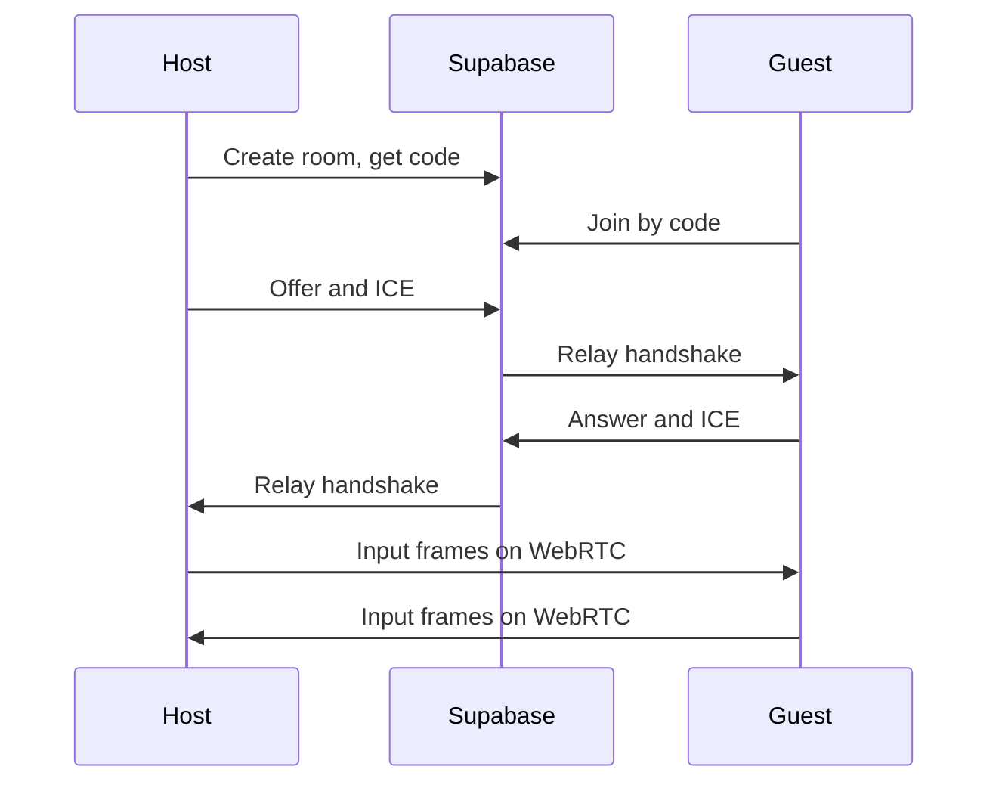

# Online 1v1 with a free Supabase project

Local versus stays as it is. Online is a second path: two PCs, a room code, then the same match scene. Supabase is the lobby, not the game server.

A free project allows 200 concurrent Realtime connections, **100 messages per second for the whole project**, and 2 million messages a month. Two players sending an input every physics frame is already 120 messages per second, so fight traffic cannot go through Realtime. Realtime only carries room updates and the WebRTC offer, answer, and ICE candidates (a few dozen messages per match). After the handshake, inputs travel on a peer-to-peer data channel and do not count against that quota.

Free projects also sleep after a week idle. The first online click may take a few seconds while the project wakes.

## This Supabase project

The free project already exists: [dashboard](https://supabase.com/dashboard/project/zxtvgiwlmhhcwxldfnot). Ref is `zxtvgiwlmhhcwxldfnot`.

- REST and Auth base: `https://zxtvgiwlmhhcwxldfnot.supabase.co`
- Realtime socket: `wss://zxtvgiwlmhhcwxldfnot.supabase.co/realtime/v1/websocket`
- Postgres host (schema only): `db.zxtvgiwlmhhcwxldfnot.supabase.co`, database `postgres`, user `postgres`, port `5432`
- Database password: `MightNite@2026@`. In a connection string the `@` signs are `%40`, so the userinfo is `MightNite%402026%40`.

The database password is only for applying the rooms SQL from this machine. The game never sees it. The client uses the project URL plus the anon key from Project Settings, API, in that dashboard. That anon key is not in this plan yet; implementation reads it from the dashboard and writes it to a gitignored [Core/SupabaseConfig.gd](Core/SupabaseConfig.gd). An example file without secrets is what gets committed.

This plan file is not gitignored. Do not commit it while the password is written here. Before any commit, add `.cursor/plans/` to [.gitignore](.gitignore) or delete the password line.

No Supabase Auth accounts. Room code is the access control.

- Table `rooms`: short code, status (`lobby`, `select`, `fight`, `done`), host and guest client ids, both character ids, stage id, game version, `created_at`.
- Realtime enabled on `rooms`, plus a public broadcast channel named by the room code for the handshake only.
- RLS so the anon key can insert a room, read a room by code, and update that row. It cannot read other tables.
- Delete the row when the match ends. Ignore rows older than an hour if a client crashes.

## Lobby in the game

[Scenes/MainMenu.gd](Scenes/MainMenu.gd) keeps **FIGHT** for local play and gains **ONLINE**.

- Host: `POST /rest/v1/rooms`, show a 4-character code.
- Guest: type the code, claim the empty guest slot.
- Both subscribe to that row. Host picks the stage. Each player only moves their own cursor on the existing roster in [Scenes/CharacterSelect.gd](Scenes/CharacterSelect.gd).
- Mismatched game version refuses the join.
- When both are ready, status becomes `fight` and both load [Scenes/Match.tscn](Scenes/Match.tscn) with the same character and stage data already stored on [Core/GameManager.gd](Core/GameManager.gd).

A small autoload speaks HTTP for the row and the Phoenix websocket for one Realtime channel (join, broadcast, heartbeat). That is about one short script, not a Supabase plugin.

## The match link

Add the official Godot WebRTC extension (desktop). One unreliable, unordered data channel. STUN is `stun.l.google.com:19302`. There is no TURN server in this pass: if both routers block peer-to-peer, the lobby says the link failed instead of falling back onto Realtime. Each input packet is the frame number plus one byte for direction and six buttons.

## Delay-based lockstep

Both games simulate both fighters. Neither runs frame N until both inputs for frame N exist.

- Measure ping during the handshake. Input delay is about half the round trip, clamped to 2–8 frames (about 33–133 ms). The local player feels that delay; the remote player does not get a head start.
- [Characters/CharacterBase.gd](Characters/CharacterBase.gd) already accepts a `forced_sample` in the smoke test. Online play feeds both fighters from an input queue instead of [Systems/InputManager.gd](Systems/InputManager.gd) reading both keyboards. Your keyboard is always the local slot; the other slot is the remote packet.
- If a packet is late, the match waits a few frames (the same kind of pause as the intro lock in [Systems/MatchManager.gd](Systems/MatchManager.gd)), then raises the delay. It does not guess inputs.
- No packet for about 3 seconds returns both players to the menu.
- Camera, hit spark, shake, and sound stay local. They must not change positions or hit outcomes.

Rollback is a later project. This pass waits for the real input.

## Make the sim agree

The current fight is not safe to run twice. [Characters/CharacterBase.gd](Characters/CharacterBase.gd) moves with `move_and_slide()`, and hits come from `Area2D` overlap order in `poll_hitbox()` and [Characters/Fireball.gd](Characters/Fireball.gd). Those can differ between two machines, and the rounds would drift apart.

Gameplay steps at a fixed `1/60` second (set physics ticks to 60 in [project.godot](project.godot)):

- Integrate position in script against the stage floor and walls. Keep the existing `_separate()` push. Stop using `move_and_slide()` for fighters.
- Test hitbox against hurtbox, then the fireball circle, in a fixed order in script. Keep the rectangles for the debug draw.
- Every 30 frames, exchange health and positions rounded to a pixel. On mismatch, end the round with a desync notice instead of playing out a lie.

Local versus uses the same movement and hit tests, so the smoke test in [Tests/smoke.gd](Tests/smoke.gd) still covers them. Online itself needs two running games; the headless test can still step two fighters from a scripted input list and assert they stay in sync.
