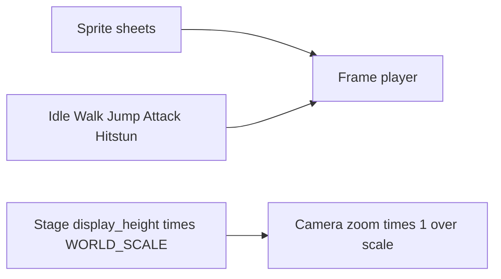

# Pixel Fighter Swap

Ryuji and Titan are single painted sprites driven by [Characters/FighterRig.gd](Characters/FighterRig.gd). The new art is pixel sprite sheets, so the limb rig goes away and each state plays a clip.

Standing figures are much shorter than the old 300–340px bodies: Martial Hero’s idle pixels are 52px tall inside a 200×200 frame, and both bandits are about 38px tall inside a 48×48 frame. Integer nearest-neighbor scale puts them on the same floor: Hero at 3× (about 156px) and both bandits at 4× (about 152px).

## Roster

All three playable sprites become fighters. The select screen in [Scenes/CharacterSelect.gd](Scenes/CharacterSelect.gd) currently places two 220px portraits per side and would overlap at three, so it becomes one shared row of three, with a P1 cursor and a P2 cursor. Portraits are the first idle frame, not the old upper-half crop of a tall painting.

- **Martial Hero** takes Ryuji’s kit: faster walk, the fireball (`236P`), uppercut, and super.
- **Heavy Bandit** takes Titan’s kit: more health, slower walk, armored heavy punch, command grab, no fireball.
- **Light Bandit** sits between them: Ryuji’s normals and specials without the projectile, no armor.

[Scenes/Match.gd](Scenes/Match.gd) stops choosing a scene by the name `"Titan"`. One [Characters/CharacterBase.tscn](Characters/CharacterBase.tscn) is spawned for every fighter. Move `.tres` files are copied onto the new characters; frame data and hitbox shapes stay as authored.

## Clips

Sheets already split cleanly. Hero frames are 200×200: Idle and Run are 8 frames, Jump and Fall are 2, Attack1 and Attack2 and Death are 6, Take Hit is 4. Each bandit folder already has Combat Idle 4, Run 8, Attack 8, Hurt 2, Jump 1, Death 1, Recover 8.

These packs have one or two attack drawings, so many buttons share a clip. The move’s startup, active, and recovery still decide when the hitbox exists; the clip is only stretched across that duration.

- Idle and block: Combat Idle for bandits, Idle for the hero
- Walk and dash: Run (dash plays faster)
- Jump: Hero uses Jump while rising and Fall while dropping. Bandits hold their single Jump frame in the air
- Light and medium attacks, including crouching and air: Hero Attack1, bandit Attack
- Heavies, specials, throw, and super: Hero Attack2, bandit Attack
- Hitstun: Take Hit / Hurt
- Knockdown: Death
- Getup: bandit Recover. The hero has no getup sheet, so getup returns to Idle

There is no crouch drawing. Crouch keeps the idle clip and lowers it to match the existing shorter hurtbox. Feet use the idle frame’s opaque bottom so every clip stands on the floor. Sprites use nearest filtering.

Copy the used sheets into `assets/fighters/martial_hero` and `assets/fighters/bandits` and point the character resources there. Remove [Characters/FighterRig.gd](Characters/FighterRig.gd), `Characters/Ryuji`, and `Characters/Titan` once the new fighters spawn.

## Arenas

The old bodies were about 320px tall against a stage `display_height` of 1100 in [Stages/Stage.gd](Stages/Stage.gd). The new bodies are about half that, so the same five backgrounds shrink by `Constants.WORLD_SCALE` (about 0.48): display height and `wall_inset` both scale, and `floor_ratio` stays so the feet remain on the painted floor.

The same factor scales gravity, walk, dash, jump, the copied speeds, hitboxes at the moment they are enabled, and the camera distances in [Scenes/Match.gd](Scenes/Match.gd) (the 280–1000 follow range, the floor offset, and the wall margin). Camera zoom is multiplied by the inverse, so the smaller world still fills the 1280×720 view the way the current fight does. The stage photos stay linear-filtered.

## Check

Update [Tests/smoke.gd](Tests/smoke.gd) for the three fighters: Hero’s light punch and fireball, Heavy’s command grab and armor, and a walk, jump, and attack clip on each. Re-run the headless smoke test, then play a match and confirm the three sprites stand on the floor of a shrunken stage without looking tiny in the frame.
