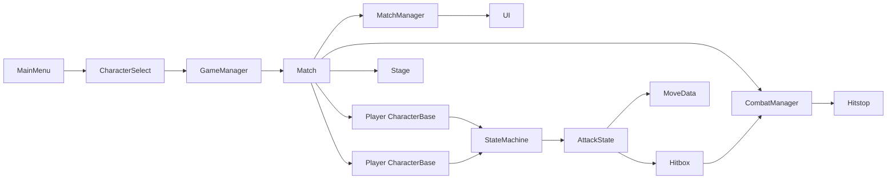

# Tekken-Style 2D Fighter MVP

Implement the vertical slice in [initial-prompt.md](initial-prompt.md) as a Godot 4 project in this repo. Scope stays local 1v1: responsive combat, short combos, two characters, best-of-3. No online, story, ranked, or super meter.

Godot 4 is already installing. Do not start another install. At execution time, use whichever binary lands first (`/Applications/Godot.app` or the Homebrew cask). Scripts stay compatible with 4.3+.

## Art on disk

`assets/` now has seven JPEGs. None are sprite sheets, and there is no audio.

Characters, both 784×1168:

- [assets/Ryuji.jpg](assets/Ryuji.jpg) — Ryuji, red-and-black stance. Fighter name stays Ryuji.
- [assets/Megaman.jpg](assets/Megaman.jpg) — the bald grappler with the T emblem. This is Titan’s sprite. The file name stays `Megaman.jpg`; the character name stays Titan.

Stages, all 1168×784, used as full backgrounds:

- [assets/Temple.jpg](assets/Temple.jpg) — Dojo. Default stage. Clearest floor.
- [assets/temple2.jpg](assets/temple2.jpg) — Shrine.
- [assets/tokyo.jpg](assets/tokyo.jpg) — Neon Roof.
- [assets/harbor.jpg](assets/harbor.jpg) — Dock 7.
- [assets/underground.jpg](assets/underground.jpg) — The Pit.

Character JPEGs have a light gray/white checkerboard baked into the pixels (JPEG has no alpha). Corners sample around `(210–255, 210–255, 210–255)`. Before they can be in-game sprites, flood-fill that backdrop from the image edges (low saturation, high luminance) and write PNGs with alpha to `assets/processed/Ryuji.png` and `assets/processed/Titan.png`. Leave the original JPEGs untouched. Stage JPEGs are opaque paintings and import as-is.

There are no attack frames. Motion is the cutout sprite plus per-state posing: horizontal flip for facing, bob and lean for walk, squash for crouch, stretch for jump, a lunge offset and rotation per move, a white flash on hit, and a tip-over on knockdown. `MoveData` stores `sprite_offset` and `sprite_rotation`. Titan’s sprite is drawn taller than Ryuji’s so the grappler reads heavier. Hurtboxes follow the opaque sprite bounds, not the full JPEG.

## Decisions

- Project lives at the repo root (`project.godot` next to [initial-prompt.md](initial-prompt.md)). Godot imports `res://assets/` directly.
- Renderer: Compatibility. Viewport 1280×720, stretch mode `viewport`, aspect `keep`.
- Simulation: 60 Hz `_physics_process` only. Frame data is integer frames.
- Hitstop is a custom pause flag on both fighters and projectiles (round timer pauses with it). UI drawing stays live.
- Keyboard plus two gamepads. Motions use numpad notation (`236P`, `623P`, `360P`, `236236P`).

## Scene and data flow

`GameManager` (autoload) stores the two selected `CharacterData` resources, the chosen `StageData`, and the round score. `Match.tscn` instances `CharacterBase.tscn` twice, applies that data, and loads the stage texture.

## Layout

- [Characters/CharacterBase.gd](Characters/CharacterBase.gd) and `.tscn` — shared body, `Sprite2D` fed by the processed PNG, hurtbox, hitbox container, state machine, input buffer, effects.
- [Characters/Ryuji/](Characters/Ryuji/) and [Characters/Titan/](Characters/Titan/) — thin scripts, `.tscn` instances, and `moves/*.tres`.
- [Systems/](Systems/) — `InputManager`, `CombatManager`, `HitboxSystem`, `HealthSystem`, `MatchManager`, `StateMachine`, and one script per state under `Systems/States/`.
- [Resources/MoveData.gd](Resources/MoveData.gd) and [Resources/CharacterData.gd](Resources/CharacterData.gd) — classes from the prompt, plus `height` (`LOW` / `MID` / `HIGH` / `UNBLOCKABLE`), `hitbox: Rect2`, `portrait` (the source JPEG, upper-body crop in UI), and `sprite` (processed PNG).
- [Resources/StageData.gd](Resources/StageData.gd) — `stage_name`, `texture`, `floor_ratio`, and side-wall insets so the invisible ground sits on the painted floor of each painting.
- [UI/](UI/), [Stages/Stage.tscn](Stages/Stage.tscn) (one scene, five `StageData` resources), [Core/Constants.gd](Core/Constants.gd), [Scenes/](Scenes/).

Physics layers in `Constants.gd`: `P1_HURT`, `P1_HIT`, `P2_HURT`, `P2_HIT`, `WORLD`. Each hitbox only masks the opponent hurtbox.

## Combat rules to implement

States on each fighter: Idle, Walk, BackWalk, Crouch, Jump (rising / apex / falling), Dash, BackDash, Attack, Block (stand / crouch), Hitstun, Blockstun, Knockdown, Getup, Throw, Thrown.

- Input buffer: 5-frame circular buffer of direction plus buttons. Specials beat normals. Same-frame chord `LP+LK` is throw.
- Block: hold back on the ground. Crouch blocks lows and mids. Stand blocks mids and overheads. Throws and command grabs are unblockable. Lows are crouching normals. Jump attacks are overheads.
- Attack: enter Attack with a `MoveData`, count frames, enable the single hitbox `Rect2` on active frames, then recovery. Cancels only during recovery if the buffered move is in `cancel_into`.
- On hit: damage (chip on block), hitstun or blockstun, knockback, optional launch, hitstop (3–8 frames), spark, combo count, scaling `0.9` per hit after the third. Combo resets when the defender leaves hitstun without being relaunched.
- Knockdown then getup with a short invulnerable window. Airborne defenders can be juggled while `launch_force` keeps them in a juggle state.
- Camera sits on the midpoint, zooms out with distance, clamps to the stage, and shakes on heavy hits.

**Ryuji** (walk faster, 900 HP): zoning plus anti-air. Normals `5LP/MP/HP`, `2LP/MP/HP`, jump LP/MP/HP. `236P` fireball projectile, `623P` uppercut launcher, `236236P` super, proximity throw.

**Titan** (slower, 1100 HP): grabs plus armor. Same normal set with more damage and longer startup. `5HP` has armor, `360P` command grab, `623P` slower launcher, `236236P` super, proximity throw.

Cancel routes stay short (normal into special into super, about 3–6 hits). Exact startup / active / recovery numbers live on the `.tres` files so tuning does not require code edits.

## Match flow

[Scenes/MainMenu.tscn](Scenes/MainMenu.tscn) to [Scenes/CharacterSelect.tscn](Scenes/CharacterSelect.tscn) to [Scenes/Match.tscn](Scenes/Match.tscn).

Character select shows the two portraits side by side (Ryuji and Titan) plus a row of the five stage thumbnails. Confirm passes both choices into `GameManager`. Default stage is the Dojo (`Temple.jpg`).

[Systems/MatchManager.gd](Systems/MatchManager.gd): 99-second timer, best-of-3, round reset positions, “KO” / “Perfect” / “Time’s Up”, match winner back to the menu. Health bars lerp. Combo counter and round announcer sit on a `CanvasLayer`. Each stage is a background sprite, an invisible floor at that stage’s `floor_ratio`, and left/right walls. No hazards.

## Build order

1. Locate the Godot 4 binary once the install finishes. Write `project.godot` (input map, layers, 60 Hz, window, autoloads) and the folder tree.
2. Cut out the two character JPEGs to PNG. Author five `StageData` resources pointing at the stage paintings.
3. `CharacterBase` movement and facing on those sprites, `InputManager`, state machine, camera.
4. One light attack end to end: `MoveData`, hitbox, damage, hitstun, block, hitstop, spark.
5. Full normal sets, cancels, scaling, combo counter, knockdown and getup, juggles.
6. Ryuji fireball and uppercut; Titan armor and command grab; both supers and throws.
7. Match manager, HUD, character select, stage thumbnails, main menu, round announcer.
8. Screen shake, block sparks, silent-safe SFX hooks (no audio files in `assets/`), debug overlay (state name, hitbox rects, combo).

## Verification

Headless: `godot --headless --import --quit` and a script check so every scene loads. Playtest in the editor: keyboard versus keyboard, then one gamepad if present. Confirm the cutout sprites have no checkerboard halo, each stage’s floor lines up with the fighters’ feet, walk, jump, block, a 3-hit cancel combo, fireball, launcher juggle, command grab, round win, and best-of-3 reset. This is a Godot game, so browser checks do not apply.
