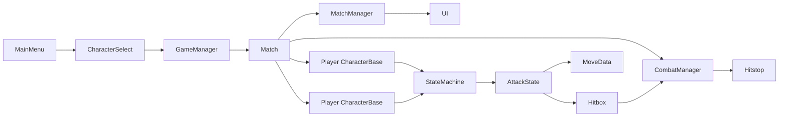

# Tekken-Style 2D Fighter MVP

Implement the vertical slice in [initial-prompt.md](initial-prompt.md) as a Godot 4 project in this repo. Scope stays local 1v1: responsive combat, short combos, one stage, two characters, best-of-3. No online, story, ranked, or super meter.

`assets/` exists and is empty, and Godot is not installed. The first pass uses generated placeholder bodies (colored polygons). `CharacterData` keeps an optional sprite path so files dropped into `assets/` later replace placeholders without combat changes.

## Decisions

- Godot 4 stable via `brew install --cask godot`. Scripts stay compatible with 4.3+ (no newer-only APIs).
- Project lives at the repo root (`project.godot` next to [initial-prompt.md](initial-prompt.md)).
- Renderer: Compatibility. Viewport 1280×720, stretch mode `viewport`, aspect `keep`.
- Simulation: 60 Hz `_physics_process` only. Frame data is integer frames.
- Hitstop is a custom pause flag on both fighters and projectiles (round timer pauses with it). UI drawing stays live.
- Keyboard plus two gamepads. Motions use numpad notation (`236P`, `623P`, `360P`, `236236P`).

## Scene and data flow

`GameManager` (autoload) stores the two selected `CharacterData` resources and round score, then `Match.tscn` instances `CharacterBase.tscn` twice and applies that data.

## Layout

Follow the tree in the prompt, plus states and a placeholder art hook:

- [Characters/CharacterBase.gd](Characters/CharacterBase.gd) and `.tscn` — shared body, hurtbox, hitbox container, state machine, input buffer, effects.
- [Characters/Ryuji/](Characters/Ryuji/) and [Characters/Titan/](Characters/Titan/) — thin scripts, `.tscn` instances, and `moves/*.tres`.
- [Systems/](Systems/) — `InputManager`, `CombatManager`, `HitboxSystem`, `HealthSystem`, `MatchManager`, `StateMachine`, and one script per state under `Systems/States/`.
- [Resources/MoveData.gd](Resources/MoveData.gd) and [Resources/CharacterData.gd](Resources/CharacterData.gd) — classes from the prompt, plus `height` (`LOW` / `MID` / `HIGH` / `UNBLOCKABLE`), `hitbox: Rect2`, and optional `sprite_path`.
- [UI/](UI/), [Stages/TrainingStage.tscn](Stages/TrainingStage.tscn), [Core/Constants.gd](Core/Constants.gd), [Scenes/](Scenes/).
- [assets/characters/](assets/characters/), [assets/stage/](assets/stage/), [assets/sfx/](assets/sfx/) — empty drop folders. If `sprite_path` is missing, draw a rectangle (Ryuji slim/red, Titan wide/steel).

Physics layers in `Constants.gd`: `P1_HURT`, `P1_HIT`, `P2_HURT`, `P2_HIT`, `WORLD`. Each hitbox only masks the opponent hurtbox.

## Combat rules to implement

States on each fighter: Idle, Walk, BackWalk, Crouch, Jump (rising / apex / falling), Dash, BackDash, Attack, Block (stand / crouch), Hitstun, Blockstun, Knockdown, Getup, Throw, Thrown.

- Input buffer: 5-frame circular buffer of direction plus buttons. Specials beat normals. Same-frame chord `LP+LK` is throw.
- Block: hold back on the ground. Crouch blocks lows and mids. Stand blocks mids and overheads. Throws and command grabs are unblockable. Lows are crouching normals. Jump attacks are overheads.
- Attack: enter Attack with a `MoveData`, count frames, enable the single hitbox `Rect2` on active frames, then recovery. Cancels only during recovery if the buffered move is in `cancel_into`.
- On hit: damage (chip on block), hitstun or blockstun, knockback, optional launch, hitstop (3–8 frames), spark, combo count, scaling `0.9` per hit after the third. Combo resets when the defender leaves hitstun without being relaunched.
- Knockdown then getup with a short invulnerable window. Airborne defenders can be juggled while `launch_force` keeps them in a juggle state.
- Camera sits on the midpoint, zooms out with distance, clamps to the stage, and shakes on heavy hits.

**Ryuji** (walk faster, 900 HP): zoning plus anti-air. Normals `5LP/MP/HP`, `2LP/MP/HP`, jump LP/MP/HP. `236P` fireball projectile, `623P` uppercut launcher, `236236P` super, proximity throw.

**Titan** (slower, 1100 HP): grabs plus armor. Same normal set with more damage and longer startup. `5HP` has armor, `360P` command grab, `623P` slower launcher, `236236P` super, proximity throw.

Cancel routes stay short (normal into special into super, about 3–6 hits). Exact startup / active / recovery numbers live on the `.tres` files so tuning does not require code edits.

## Match flow

[Scenes/MainMenu.tscn](Scenes/MainMenu.tscn) to [Scenes/CharacterSelect.tscn](Scenes/CharacterSelect.tscn) (side-by-side portrait stand-ins, name, confirm) to [Scenes/Match.tscn](Scenes/Match.tscn).

[Systems/MatchManager.gd](Systems/MatchManager.gd): 99-second timer, best-of-3, round reset positions, “KO” / “Perfect” / “Time’s Up”, match winner back to the menu. Health bars lerp. Combo counter and round announcer sit on a `CanvasLayer`.

Training stage: flat ground, left and right walls, simple background. No hazards.

## Build order

1. Install Godot, write `project.godot` (input map, layers, 60 Hz, window, autoloads), and the folder tree.
2. `CharacterBase` movement and facing, `InputManager`, state machine, placeholder draw, camera.
3. One light attack end to end: `MoveData`, hitbox, damage, hitstun, block, hitstop, spark.
4. Full normal sets, cancels, scaling, combo counter, knockdown and getup, juggles.
5. Ryuji fireball and uppercut; Titan armor and command grab; both supers and throws.
6. Match manager, HUD, character select, main menu, round announcer.
7. Screen shake, block sparks, placeholder SFX calls (silent if files are missing), debug overlay (state name, hitbox rects, combo).

## Verification

Headless: `godot --headless --import --quit` and a script check so every scene loads. Playtest in the editor: keyboard versus keyboard, then one gamepad if present. Confirm walk, jump, block, a 3-hit cancel combo, fireball, launcher juggle, command grab, round win, and best-of-3 reset. This is a Godot game, so browser checks do not apply.
